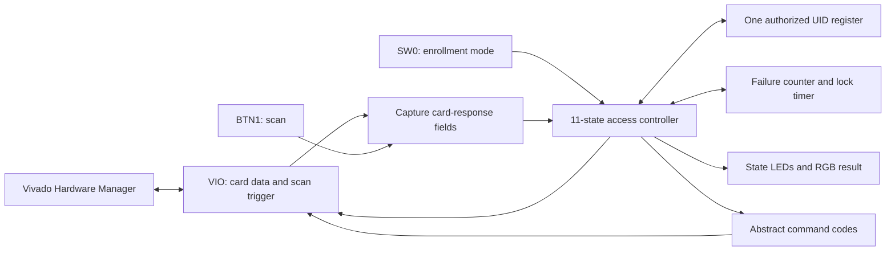

# FPGA RFID Access Control

[](https://github.com/baconkak/fpga-rfid-access-control/actions/workflows/rtl-simulation.yml)

A Verilog access-control prototype for the **PYNQ-Z2**, with a card-selection state machine, single-card enrollment, timed lockout, and live signal inspection through Vivado VIO.

**Scope:** Card responses are supplied through VIO or a testbench. This project implements the digital control logic; it does not yet communicate with a physical RFID reader or implement the complete ISO/IEC 14443 protocol.

[คำอธิบายภาษาไทย](docs/README.th.md) · [Design and limitations](docs/design.md) · [Verification evidence](docs/verification.md)

## What it demonstrates

- **RTL design:** An 11-state finite state machine (FSM), sequential/combinational logic, and transaction data capture.
- **Access decisions:** Check ATQA `0x0004`, a 32-bit UID, and SAK `0x08`; accept the enrolled UID or reject it.
- **Enrollment:** Replace the single authorized UID using a board switch and a scan event.
- **Lockout:** Enter a timed lockout after three consecutive UID mismatches that reach the access-check stage.
- **FPGA integration:** A 125 MHz clock, PYNQ-Z2 pin constraints, state LEDs, and RGB status outputs.
- **Verification:** A self-checking RTL regression with an exported signal trace and GitHub Actions automation.

**Local validation:** 23 checks passed with Vivado XSim 2024.1 on 20 November 2026. The Vivado project-recreation script also completed successfully. [View evidence](docs/verification.md).

ATQA and SAK are card-response fields used here as fixed compatibility checks. The UID is the card identifier used for comparison, not a cryptographic credential.

## Architecture



Normal path:

```text
IDLE → SEND_REQA → WAIT_ATQA → SEND_ANTICOLL → WAIT_UID
     → SEND_SELECT → WAIT_SAK → CHECK_ACCESS → GRANTED / DENIED / LOCKED
```

The command output exposes `0x26`, `0x93`, and `0x70` at the corresponding states. These are debug-level command codes, not serialized RF frames. All response fields are captured together on the scan event.

## Quick start: simulate without a board

Requires **Python 3.9+** and either **Vivado 2024.1 / XSim** or **Icarus Verilog**. No Python packages are required.

```sh
git clone https://github.com/baconkak/fpga-rfid-access-control.git
cd fpga-rfid-access-control
```

With Vivado tools on `PATH`:

```sh
python scripts/run_sim.py
```

On Windows, an explicit installation path can be supplied:

```powershell
python scripts/run_sim.py --vivado-bin "C:\Xilinx\Vivado\2024.1\bin"
```

With Icarus Verilog (`iverilog` and `vvp` on `PATH`):

```sh
python scripts/run_sim.py --simulator iverilog
```

The runner returns a failure exit code if compilation, assertions, or the simulation watchdog fail. A successful run prints `ALL TESTS PASSED` with the number of checks. The transcript and per-clock `trace.csv` are saved under `build/sim_xsim/` or `build/sim_iverilog/`.

## Recreate the FPGA project

Target: **PYNQ-Z2 / Zynq-7000 XC7Z020-CLG400-1**, Vivado **2024.1**.

From a Vivado-enabled terminal in the repository root:

```sh
vivado -mode batch -source scripts/create_project.tcl
```

Open `build/vivado/rfid_access.xpr` in Vivado, then run synthesis, implementation, and bitstream generation. Alternatively, generate the project and build it in one invocation from a fresh checkout:

```sh
vivado -mode batch -source scripts/create_project.tcl -tclargs build
```

The script recreates the VIO IP with the original probe widths and initial values. It refuses to overwrite an existing generated project. The original `RFIDProj/RFIDProj.xpr` and source configuration are also preserved for reference.

## Board demonstration

After building and programming the board through Vivado Hardware Manager:

1. Press **BTN0** to reset. Keep **SW0 = 0** for normal access checking.
2. In VIO, set `probe_out1 = 0x0004` (ATQA), `probe_out2 = 0x904B0296` (UID), and `probe_out3 = 0x08` (SAK). These are also the VIO power-up values.
3. Toggle `probe_out0` from `0` to `1` and back to `0`. Green indicates access granted. Keep BTN1 released when using the VIO trigger.
4. Try a different UID three times with the same ATQA and SAK. The controller enters state `10` until the lockout expires.
5. After unlocking, set **SW0 = 1**, provide a new UID, and trigger one scan. Return SW0 to `0` and scan again to test the replacement UID.

`probe_in0` shows the state number and `probe_in1` shows the command code. BTN1 can also request a scan, using the card fields currently set in VIO. Registration is lost on reset. The LED result remains active until another transaction or reset.

This is a reproducible demo procedure; a physical-board demonstration has not been independently verified for this repository release. Mechanical buttons are not debounced, so VIO is the preferred trigger for repeatable testing.

## Implementation evidence

Existing Vivado reports dated **16 November 2026** record the following results for the board-level design, **including VIO/debug infrastructure**:

| Metric | Archived result |
| --- | ---: |
| Clock constraint | 125 MHz / 8 ns |
| Slice LUTs | 698 / 53,200 (1.31%) |
| Slice registers | 1,332 / 106,400 (1.25%) |
| Worst setup slack | +2.732 ns |
| Worst hold slack | +0.061 ns |
| Failing setup / hold endpoints | 0 / 0 |

These are archived build results, not a new hardware measurement. The reports flag missing input/output delays and methodology warnings; positive slack applies to the paths covered by the supplied constraints. See the [report excerpts and validation details](docs/verification.md).

## Repository layout

```text
RFIDProj/
  RFIDProj.xpr                     Original Vivado project
  RFIDProj.srcs/
    sources_1/new/
      rfid_reader_top.v            Access-control RTL
      pynq_rfid_system.v           Board wrapper and VIO wiring
      tb_rfid_reader.v             Original waveform-oriented testbench
    sources_1/ip/vio_0/vio_0.xci    Original VIO configuration
    constrs_1/new/pynq_z2.xdc       Clock and pin constraints
verification/tb_rfid_access.v      Self-checking regression
scripts/run_sim.py                 Portable simulation runner
scripts/create_project.tcl         Recreate / build Vivado project
docs/                             Design notes and evidence
.github/workflows/                 Automated RTL simulation
```

Generated caches, implementation directories, bitstreams, and simulator output stay out of version control.

## Current boundaries and next steps

- Connect an RFID front end and implement real request/response handshakes, framing, collision handling, and protocol timing.
- Add switch/button synchronization and debounce logic, and review the trigger edge detector for safe clock-domain crossing.
- Add authenticated enrollment, persistent multi-card storage, and stronger access authentication.
- Make failure-count behavior consistent across unsupported card fields and UID mismatches; the current behavior is documented and tested.
- Replace the fast lockout status toggle with a human-visible blink and complete board-level timing review.

The project is an educational digital-design prototype. The registered UID alone does not provide secure card authentication.
